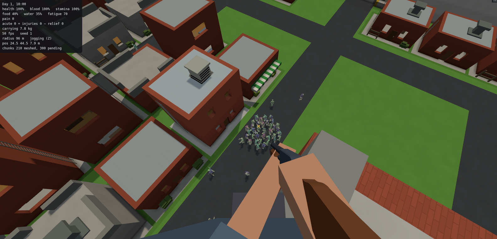

---
read_if:
  - you're new to skelly and want to know what it is
  - you want to play it, or run and check it locally
  - you check the code and shared asset licences
---

# skelly

skelly is a hobby monorepo built around **deadvox**, a voxel survival game that runs in the browser. Its creatures come from a generator in the same repository, and its models from authoring tools in the shared asset submodule. The point is to have fun.



**Play:** <https://roobie.github.io/skelly/> opens a launcher for the game and the mobgen viewer.

## Projects

- **[deadvox](packages/deadvox/PROJECT.md)**: the game. You scavenge a large voxel world full of zombies, with detailed items, bodies and crafting. It runs entirely in the browser, with no server.
- **[mobgen](packages/mobgen/PROJECT.md)**: a procedural generator of voxel creatures, from humanoids to crawlers and dogs, with bodies that can be severed.
- **[skelly-assets](https://github.com/roobie/skelly-assets)**: the shared models and the pipelines that build them, including the gun and thing authoring tools, checked out as the `packages/skelly-assets` submodule.
- **[things](things/README.md)**: the plan for the thing authoring tools replacing gungen as the source of deadvox's models.

## Run and check locally

You need Node.js and npm. The projects are npm workspaces of the root package. From the repository root, one command initializes the shared asset submodule and installs the workspaces, the lit-check tool and the pinned Jsonnet compiler:

```sh
npm run setup
```

Start a project's dev server:

```sh
npm run dev --prefix packages/deadvox
npm run dev --prefix packages/mobgen
```

Run the repository-wide checks with `npm run ci` and `npm run test:site`. Each project's `package.json` lists its own checks, and CI runs the workflows under `.github/workflows/`.

## Licence

Game code, pipeline tools and the asset showcase use EUPL-1.2. The shared models and built assets in [skelly-assets](https://github.com/roobie/skelly-assets) use CC-BY-NC-SA-4.0, which restricts commercial use. Keeping the scopes separate shares the tools without relicensing the models; see `REUSE.toml` and the submodule's [REUSE.toml](https://github.com/roobie/skelly-assets/blob/main/REUSE.toml).

Contributing? Start with [AGENTS.md](AGENTS.md), [PILLARS.md](PILLARS.md) and [docs/PROCESS.md](docs/PROCESS.md).
