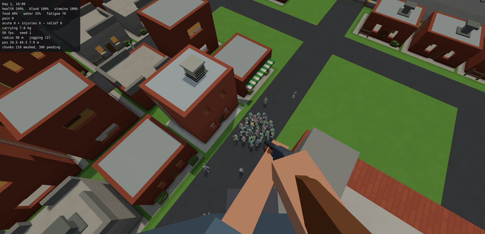

---
read_if:
  - you're new to skelly and want to know what it is
  - you want to play it, or run and check it locally
---

# skelly

skelly is a hobby monorepo built around **deadvox**, a voxel survival game that runs in the browser. Its firearms come from an authoring tool and its creatures from a generator, both in the same repository, and a shared engine sits under them. The point is to have fun.



**Play:** <https://roobie.github.io/skelly/> opens a launcher for the game and the viewers of gungen and mobgen.

## Projects

- **[deadvox](packages/deadvox/PROJECT.md)**: the game. You scavenge a large voxel world full of zombies, with detailed items, bodies and crafting. It runs entirely in the browser, with no server.
- **[gungen](gungen/PROJECT.md)**: a designer for low-poly firearms whose parts fit together and whose moving parts have room to move. It exports the guns deadvox loads.
- **[mobgen](packages/mobgen/PROJECT.md)**: a procedural generator of voxel creatures, from humanoids to crawlers and dogs, with bodies that can be severed.
- **[engine](packages/engine/README.md)**: the shared assembly, geometry and fit code that gungen builds on.
- **[things](things/README.md)**: the authoring tools and shared core, in the `thing-*` workspaces under `packages/`, that are replacing gungen as the source of deadvox's models.

## Run and check locally

You need Node.js and npm. The projects are npm workspaces of the root package. From the repository root, one command installs all of them, the lit-check tool and the pinned Jsonnet compiler:

```sh
npm run setup
```

Start a project's dev server:

```sh
npm run dev --prefix packages/deadvox
npm run dev --prefix gungen
npm run dev --prefix packages/mobgen
```

Run the repository-wide checks with `npm run ci` and `npm run test:site`. Each project's `package.json` lists its own checks, and CI runs the workflows under `.github/workflows/`.

Contributing? Start with [AGENTS.md](AGENTS.md), [PILLARS.md](PILLARS.md) and [docs/PROCESS.md](docs/PROCESS.md).
